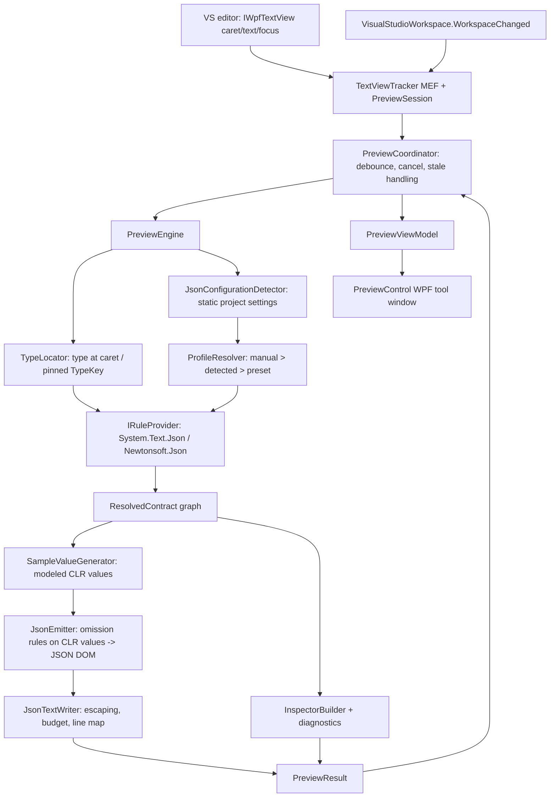

# Architecture

## Overview

RealizeJSON is an in-process Visual Studio extension (VSSDK `AsyncPackage`) with a host-independent engine. The engine
consumes Roslyn compiler symbols only; it never emits, loads or executes user code.

## Modules

| Project | Target | Responsibility | Depends on |
|---|---|---|---|
| `RealizeJSON.Core` | netstandard2.0 | Contract model, profiles/presets/precedence, preview options, diagnostics record, JSON DOM, structured writer and reader, naming algorithms, sample value model | — |
| `RealizeJSON.Diagnostics` | netstandard2.0 | Diagnostic catalog (stable `RJxxxx` IDs), sensitive-name heuristic | Core |
| `RealizeJSON.CodeAnalysis` | netstandard2.0 | Roslyn symbol helpers, `TypeLocator`, `TypeKey` (pin identity), `JsonConfigurationDetector` | Core, Diagnostics, Roslyn |
| `RealizeJSON.SampleData` | netstandard2.0 | Deterministic `SampleValueGenerator`, `JsonEmitter` | Core, Diagnostics |
| `RealizeJSON.Serialization` | netstandard2.0 | `ContractBuilderBase` pipeline, `IRuleProvider`, `PreviewEngine`, `InspectorBuilder`, shared scalar formatting | Core, CodeAnalysis, SampleData, Diagnostics |
| `RealizeJSON.Serialization.SystemTextJson` | netstandard2.0 | STJ rules and value formatter | Serialization |
| `RealizeJSON.Serialization.NewtonsoftJson` | netstandard2.0 | Newtonsoft rules and value formatter | Serialization |
| `RealizeJSON.UI` | netstandard2.0 | `PreviewCoordinator`, `PreviewViewModel`, settings persistence and migration, solution profile, host abstractions | Serialization providers |
| `RealizeJSON.VisualStudio` | net472 | VSIX host: package, commands (VSCT), async tool window, code-only WPF view, MEF text-view tracker, VS adapters, options page | UI, VS SDK |

Core logic has no dependency on Visual Studio UI or COM. All netstandard2.0 libraries run unchanged in the VS process
(.NET Framework) and in the .NET 10 test host.

## Key flows

**Refresh.** Editor events (text change, caret move, focus change) and relevant workspace changes call the
coordinator, which cancels the pending request, increments a generation counter and schedules a debounced analysis on
the thread pool. Results are published only if their generation is still current, so superseded analyses can never
overwrite newer results. Caret moves first run a cheap type lookup; if the type at the caret and the text version are
unchanged, nothing is rebuilt or republished.

**Unsaved source.** The host maps the live `ITextSnapshot` to a Roslyn `Document` with
`GetOpenDocumentInCurrentContextWithChanges()`, so analysis always sees unsaved edits without building.

**Contract building.** `ContractBuilderBase` resolves each `ITypeSymbol` once per analysis (cycle-safe cache: object
contracts are registered before their members are populated). It classifies types (primitive, enum, collection,
dictionary, object, any, unsupported) and delegates member selection, naming, ordering, ignore conditions, converters,
polymorphism and formatting to the serializer provider.

**Samples and JSON.** The generator produces a modeled CLR value tree (not JSON) using deterministic heuristics, the
traversal path for cycle detection, and depth/node limits. The emitter then applies write-time omission rules to those
CLR values and produces a JSON DOM; the writer serializes it with serializer-specific escaping, a size budget (always
closing open containers) and a line-to-member map for navigation.

**Stale handling.** If the source has syntax errors and a valid preview of the same type exists, that preview is kept
and marked *Stale*; otherwise the partial result is shown with diagnostics. Analysis failures keep the last valid
preview with an RJ0005 diagnostic.

## Threading and lifecycle

- The package loads on demand (no auto-load). Services are resolved on a background thread in
  `InitializeToolWindowAsync`; UI objects are created on the UI thread.
- Analysis runs on the thread pool; only caret/snapshot capture and view-model updates use the UI thread, via
  `JoinableTaskFactory.SwitchToMainThreadAsync` (no blocking waits, no sync-over-async).
- At most one analysis is active per window; superseded tasks are cancelled cooperatively.
- Hidden windows do not analyze; showing the window refreshes if anything changed.
- `PreviewSession.Dispose` unsubscribes editor, workspace and options events and disposes the coordinator and view
  model. Solution close clears caches and pinned state.
- No compilation or semantic model is retained between analyses; pinned types are stored as `TypeKey` strings and
  re-resolved against the current compilation. The configuration detector caches per-document results keyed by text
  version (bounded to 16 projects).

## Bounds

| Resource | Bound |
|---|---|
| Contracts per analysis | 4,000 types |
| Sample nodes | `MaxNodes` (default 2,000) |
| Depth | `MaxDepth` (default 8) |
| Output | `MaxBytes` (default 256 KiB) |
| Inspector rows | 500 (depth 4) |
| Tree view nodes | 2,000 |
| Syntax highlighting | First 3,000 lines (plain text beyond) |
| Settings / solution profile input | 1 MiB / 64 KiB, depth 64 |

## Packaging

The VSIX contains only `RealizeJSON.*` assemblies; Roslyn, editor and shell assemblies come from Visual Studio
(`ExcludeAssets="runtime"` plus a build target that removes non-RealizeJSON copy-local files). `[ProvideBindingPath]`
lets Visual Studio resolve the library assemblies from the extension folder.
